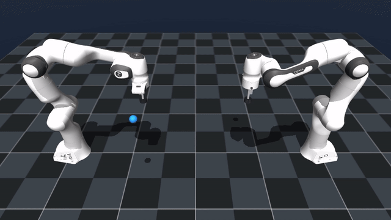
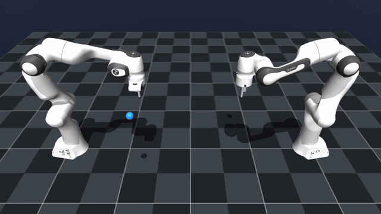
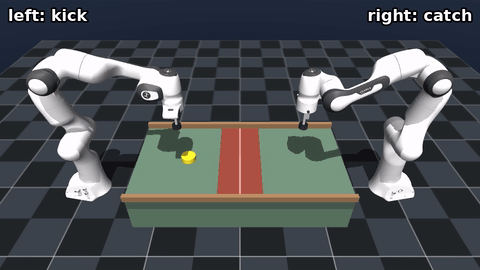
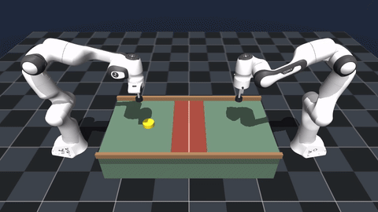
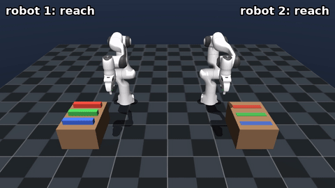
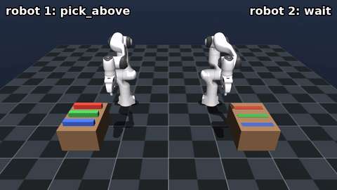

# Collaborative MPPI

This project studies **collaborative manipulation with two Franka arms and Model Predictive Path Integral control (MPPI)** in MuJoCo.

The two arms (facing each other, or side by side for object handling) are controlled either by one **centralized** MPPI over both arms, or by one **decentralized** MPPI per arm that rolls out the other arm along its previous plan. MPPI can sample with the Standard, Pink, Poisson or Spike proposal (see [Franka_MPPI](https://github.com/fleurssauvages/Franka_MPPI)).

## Demo

<h3 align="center">Reaching</h3>

<table align="center" width="100%">
  <tr>
    <th width="50%">Centralized Spike-MPPI (32 rollouts)</th>
    <th width="50%">Decentralized Spike-MPPI (32 rollouts per arm)</th>
  </tr>
  <tr>
    <td align="center">
      
    </td>
    <td align="center">
      
    </td>
  </tr>
</table>

<br>

<h3 align="center">Air Hockey</h3>

<table align="center" width="100%">
  <tr>
    <th width="50%">Centralized Spike-MPPI (32 rollouts)</th>
    <th width="50%">Decentralized Spike-MPPI (32 rollouts per arm)</th>
  </tr>
  <tr>
    <td align="center">
      
    </td>
    <td align="center">
      
    </td>
  </tr>
</table>

<br>

<h3 align="center">Object Handling</h3>

<p align="center">Robot 1 picks three boxes from its table, hands each one over in the air to robot 2, which puts it on its slot on the other table.</p>

<table align="center" width="100%">
  <tr>
    <th width="50%">Centralized Spike-MPPI (32 rollouts)</th>
    <th width="50%">Decentralized Spike-MPPI (32 rollouts per arm)</th>
  </tr>
  <tr>
    <td align="center">
      
    </td>
    <td align="center">
      
    </td>
  </tr>
</table>

## Install

Requires Python 3.10+ and MuJoCo 3.3+.

```bash
cd "Collaborative MPPI"
python3 -m venv .venv
source .venv/bin/activate
python -m pip install -r requirements.txt
```

## Run

```bash
python -m collab_mppi.reaching.run --sampler spike --layout centralized --viewer
python -m collab_mppi.air_hockey.run --sampler spike --layout decentralized --viewer
python -m collab_mppi.object_handling.run --sampler spike --layout centralized --viewer
```

Use `--sampler standard`, `pink` or `poisson` for comparison, and `--help` for all options.
